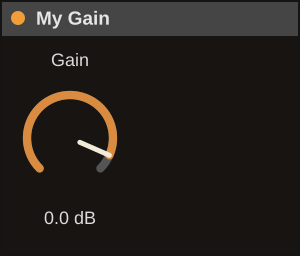

# Command line

Installing m4l-builder adds an `m4l` command (also available as
`python -m m4l_builder`). It runs your build scripts for you, rebuilds them on
save, checks them without writing anything, summarises a built `.amxd`, and
turns an existing `.amxd` into a build script.

```bash
m4l new "My Gain" --type audio     # scaffold my_gain/build.py
m4l build my_gain/build.py         # build it
m4l watch my_gain/build.py         # rebuild into the User Library on every save
m4l lint my_gain/build.py          # validate without writing
m4l preview my_gain/build.py       # render the panel to my_gain.svg
m4l inspect "My Gain.amxd"         # type, size, parameters, box counts
m4l import "Their Device.amxd"     # write a build.py that rebuilds it
m4l render my_gain/build.py --in dry.wav --out wet.wav --param Gain=-6
```

## What counts as a build script

Any Python file that makes a `Device` and calls `device.build(path)`, the way
every script in [`examples/`](https://github.com/alaarab/m4l-builder/tree/main/examples)
does. The CLI runs the script as `__main__` and intercepts each
`device.build(...)` call, so it can redirect the write (`build --out`), send it
to the User Library (`watch`) or skip it entirely (`lint`). A script that only
defines a top-level `device` or a `build_device()` function works too.

Scripts run with their own folder first on `sys.path`, so they can import
helper modules that sit next to them.

## `m4l new`

```bash
m4l new NAME [--type audio|midi|instrument] [--out PATH] [--force]
```

Writes a runnable build script, by default `<name>/build.py` (`"My Gain"`
becomes `my_gain/build.py`). Each type starts from a small working device:

| `--type` | Device | Starts with |
|---|---|---|
| `audio` (default) | `AudioEffect` | a smoothed gain dial on the stereo signal |
| `midi` | `MidiEffect` | a `midiin` to `midiout` pass-through |
| `instrument` | `Instrument` | a sine voice with an ADSR envelope and a level dial |

Every scaffold lints clean. `new` never overwrites a file unless you pass
`--force`.

## `m4l build`

```bash
m4l build SCRIPT [--out PATH]
```

Runs the script and prints where each device went. Without `--out`, devices
are written where the script asks; a script that never calls `build()` is
written to the User Library. `--out` redirects the write:

- `--out dist/` keeps each build's own file name inside `dist/`.
- `--out "Release.amxd"` writes a single device to that file (an error if the
  script builds more than one).

## `m4l watch`

```bash
m4l watch SCRIPT [--out PATH] [--interval SECONDS] [--live [--live-port PORT]]
```

Checks the script's modification time (every 0.5 s by default) and rebuilds
it on every save, straight into your Ableton User Library
(`device_output_path`, which honours `M4L_USER_LIBRARY`). After each build it
prints what changed:

```text
watching my_gain/build.py (Ctrl-C to stop)
[14:02:11] built My Gain -> ~/Music/Ableton/User Library/Presets/Audio Effects/Max Audio Effect/My Gain.amxd
           first build: 9 boxes, 9 lines, 1 parameter(s)
[14:03:40] built My Gain -> ~/Music/Ableton/User Library/Presets/Audio Effects/Max Audio Effect/My Gain.amxd
           + boxes: drive
           + parameter: Drive
           bytes: 6,605 -> 7,412
```

A script that raises prints the error and the watch carries on, so a
half-typed edit doesn't end the session. Only the script file itself is
watched; restart the watch after editing a helper module it imports.

### Hot reload into Live: `--live`

With `--live`, each build is also swapped into the Live set you have open, so
you hear the change a moment after you save:

```text
watching my_gain/build.py (Ctrl-C to stop)
live: connected to LiveMCP on 127.0.0.1:9877
[14:03:40] built My Gain -> ~/Music/Ableton/User Library/Presets/Audio Effects/Max Audio Effect/My Gain.amxd
           + parameter: Drive
           live: My Gain: swapped 1 copy in place, restored 1 parameter values in 0.62s
```

It needs [LiveMCP](https://github.com/alaarab/livemcp)'s remote script
running in Live (Preferences > Link, Tempo & MIDI > Control Surface: LiveMCP).
For each build it:

- finds every Max device on the set's tracks with the device's name and puts
  the new build in the same slot on the same track (LiveMCP's `replace_device`;
  older LiveMCP versions load it beside the old copy and delete the old one);
- restores parameter values by name, clamped to the new ranges. A parameter
  you renamed or removed keeps its new default, and the watch says which;
- loads the device onto the selected track if it isn't in the set yet.

Live loads devices from its browser, so the build has to land in the User
Library: the default output, or an `--out` folder inside it. A copy you
renamed in Live is left alone. Devices inside racks aren't reloaded.

If Live or LiveMCP isn't running, the watch says so once and keeps building;
the next save after Live comes back reloads again. `--live-port` changes the
port (default 9877). From Python, use `m4l_builder.live_reload.reload_device`.

## `m4l lint`

```bash
m4l lint SCRIPT|DEVICE.amxd [--strict]
```

Builds the device in memory (nothing is written) and runs the library's checks:

- **graph validation**: unknown patchline endpoints, out-of-range inlets and
  outlets, duplicate ids, unreachable controls, layout warnings
  (`Device.lint`);
- **box lint**: inlet/outlet declarations compared against the vendored Max
  object dataset;
- **GenExpr lint**: every gen~ codebox, embedded or in a `.gendsp` file,
  checked for unassigned outputs, out-of-range `in`/`out` indexes and
  multi-line ternaries;
- **jsui coverage**: messages routed to a jsui/v8ui script that defines no
  handler for them.

It exits 1 when any error is found, or with `--strict` when any warning is.

## `m4l preview`

```bash
m4l preview SCRIPT|DEVICE.amxd [--out PATH] [--scale N] [--no-frame]
```

Draws the device's presentation view as an SVG, with nothing written to the
User Library:



- **Drawn from the patcher:** every visible box with a `presentation_rect`,
  in its theme colours, background boxes first.
- **Native controls** (`live.dial`, `live.slider`, `live.toggle`, `live.text`,
  `live.menu`, `live.tab`, `live.numbox`, meters, scopes, comments and panels)
  are drawn as close approximations at their initial values. Dials and sliders
  show the parameter name and the value formatted in its unit style (`1.00 kHz`,
  `-6.0 dB`, `25L`).
- **jsui / v8ui engines** draw at runtime, so they appear as dashed
  placeholders labelled with their script name. Any other object appears as a
  labelled outline.

Output goes to `<device name>.svg` in the current folder (`"My Gain"` becomes
`my_gain.svg`). `--out` takes a `.svg` file or a directory. `--scale 2`
doubles the displayed size (the drawing stays vector). `--no-frame` drops the
title strip. From Python:

```python
from m4l_builder.preview import render_svg

svg = render_svg(device, scale=2)  # a Device, a patcher dict or a .amxd path
```

It's an approximation for docs, code review and spotting layout mistakes, not
a pixel match with Live. See the [example gallery](gallery.md).

## `m4l inspect`

```bash
m4l inspect DEVICE.amxd [--json]
```

```text
My Gain  (audio_effect, 150 x 110 px)
  file        My Gain.amxd  (6,605 bytes)
  boxes       9 (2 in presentation), 9 patch lines
  maxclasses  newobj 7, live.dial 1, panel 1
  objects     *~ 2, dbtoa 1, line~ 1, pack 1, plugin~ 1, plugout~ 1
  parameters  1
    - Gain (float: -70.0 .. 6.0, initial 0.0)
```

`--json` prints the same summary as JSON for scripts and CI.

## `m4l import`

```bash
m4l import DEVICE.amxd [--out PATH] [--force] [--no-check]
```

Writes a build script (by default `<name>/build.py`) that rebuilds an existing
device, with its scripts and `.gendsp` files beside it, then runs the script
and confirms it builds an identical device. Boxes no library call can
reproduce are kept as raw `add_box` dicts marked `TODO(m4l import)` and listed
in the output. It exits 1 when the rebuilt device differs. See
[Bring an existing device](importing.md).

## `m4l render`

```bash
m4l render SCRIPT|DEVICE.amxd [--in WAV | --signal sine|noise|impulse|silence]
           [--out WAV] [--param NAME=VALUE ...] [--seconds S] [--samplerate HZ]
           [--level DB] [--freq HZ] [--seed N] [--device NAME] [--strict]
           [--check] [--json]
```

Runs the device's audio path in Python, without Live: `plugin~` to `plugout~`
through gen~ codeboxes (simulated by `gen_sim`), MSP arithmetic and the
parameter controls that feed them. The input is a WAV (`--in`) or a generated
signal (default: 1 s of noise at -6 dBFS, different on each channel so
stereo effects have something to act on). `--param` sets parameters by their
Live name (or a gen `Param` as `BOX.param`); the rest keep their initial
values. `--out` writes the result as 24-bit PCM.

```text
$ m4l render examples/03_stereo_width.py --param wid_width=2 --out wide.wav
Widener: rendered 1.00 s of noise at 48000 Hz through 12 boxes
  params      wid_width = 2
  dBFS            in L    in R   out L   out R
  rms            -10.8   -10.8    -6.8    -6.8
  peak            -6.0    -6.0     0.0     0.0
  20-120 Hz      -35.3   -35.5   -31.6   -31.7
  ...
  change      ch1 -3.0 dB, ch2 -3.0 dB
  note        'wid_smooth_line' [line~] is held at its target 2 from the first sample (the ramp is not rendered)
wrote wide.wav (24-bit PCM)
```

`change` is the level of output minus input, relative to the input. When the
output is the input untouched (a gen~ that failed to compile, a parameter that
isn't wired) the line ends `<- DRY`, and `--check` makes that, or any NaN/Inf
in the output, exit 1. `--json` prints the same numbers for scripts.

A device that holds anything the renderer can't run fails with the box's id,
rather than rendering something wrong. See [Offline render](render.md) for what
is supported and for the Python API and checks.
