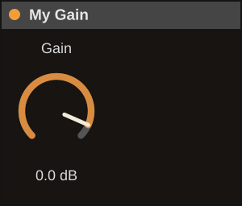
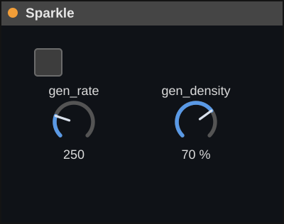
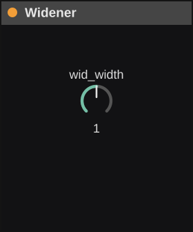
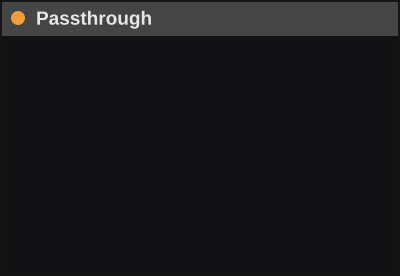
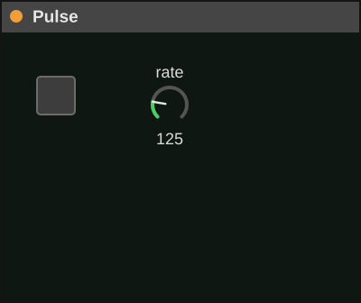
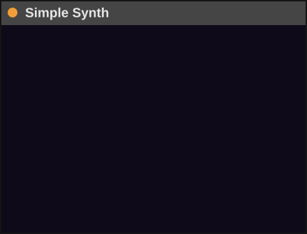

# Example gallery

The six scripts in
[`examples/`](https://github.com/alaarab/m4l-builder/tree/main/examples), as
`m4l preview` draws them: the presentation view in each device's theme
colours, with every control at its initial value.

| | | |
|:---:|:---:|:---:|
|  |  |  |
| [`01_gain_audio_effect.py`](https://github.com/alaarab/m4l-builder/blob/main/examples/01_gain_audio_effect.py)<br>audio effect, low-level API | [`02_generative_midi.py`](https://github.com/alaarab/m4l-builder/blob/main/examples/02_generative_midi.py)<br>generative MIDI recipe | [`03_stereo_width.py`](https://github.com/alaarab/m4l-builder/blob/main/examples/03_stereo_width.py)<br>mid/side width recipe |
|  |  |  |
| [`04_midi_transformation.py`](https://github.com/alaarab/m4l-builder/blob/main/examples/04_midi_transformation.py)<br>Live 12 MIDI Tool | [`05_euclidean_midi.py`](https://github.com/alaarab/m4l-builder/blob/main/examples/05_euclidean_midi.py)<br>Euclidean rhythm | [`06_simple_synth.py`](https://github.com/alaarab/m4l-builder/blob/main/examples/06_simple_synth.py)<br>instrument |

Passthrough and Simple Synth have no on-panel controls yet, so they show only
their themed panel.

## Make your own

```bash
m4l preview my_device/build.py --out previews/ --scale 2
```

The previews here are regenerated with `make previews`, and
`tests/test_preview.py` fails when they drift from what the renderer draws.
See [Command line](cli.md#m4l-preview) for the options.
